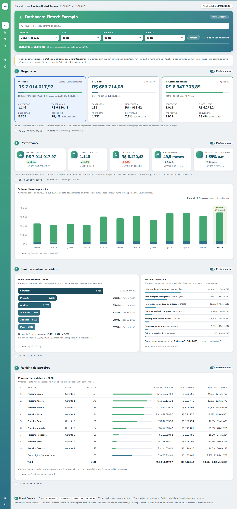
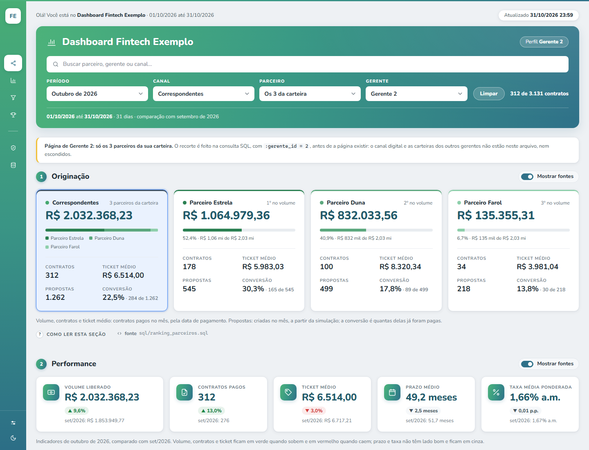

# Dashboard comercial de BI

Mini dashboard comercial da **Fintech Exemplo**, uma financeira fictícia de crédito consignado. Um script lê uma base SQLite, aplica as regras de negócio em Python e escreve uma página HTML autocontida por perfil: a diretoria vê tudo; cada gerente vê só os parceiros da própria carteira.

O desenho em camadas é o que uso no trabalho, refeito do zero com dados fictícios: **banco → SQL → regras em Python → página HTML**.

## O problema que ele espelha

Quem vende crédito pelo canal digital e por correspondentes acompanha volume, conversão e parceiros todo dia. Dois cuidados pesam mais que o gráfico: cada gerente só pode ver a própria carteira, e todo número precisa mostrar de onde veio, para que uma divergência seja conferida em minutos, e não em reunião.

## Como rodar

Python 3.10 ou mais novo, só com a biblioteca padrão.

```bash
python build.py                       # gera a base (se faltar) e as páginas em saida/
python build.py --perfil gerente-2    # só um perfil
python gerar_base.py                  # recria a base fictícia (semente 42: sai sempre igual)
python -m unittest discover -s testes -v
```

Depois, abra `saida/diretoria.html` no navegador. As pastas `dados/` e `saida/` ficam fora do Git: os comandos acima as recriam.

Para atualizar as páginas a cada 5 minutos no Windows, `.\agendar.ps1` mostra a tarefa do Agendador que seria criada. Ele só grava com `-Registrar`.

## Estrutura

```
01-dashboard-bi/
├── gerar_base.py   base fictícia → dados/base.sqlite
├── sql/            uma consulta por quadro; o comentário do topo diz o que mostra e o que usa
├── kpis.py         regras: roda as consultas e monta o payload de cada perfil
├── render.py       payload → HTML autocontido: gráfico e ícones em SVG, funil e barras em HTML
├── estilo.css      o CSS que o render.py embute na página
├── fontes/         Nunito e a licença dela (SIL OFL 1.1); o render.py embute a fonte na página
├── build.py        orquestra tudo e grava saida/<perfil>.html
├── agendar.ps1     atualização a cada 5 minutos pelo Agendador do Windows (simula por padrão)
├── testes/         unittest
└── img/            as capturas abaixo
```

## Exemplo de saída

O visual segue o mesmo padrão do painel que construí no trabalho: barra lateral em degradê, faixa de filtros, cartões de origem e funil em rampa.

Página da diretoria, mês de referência outubro de 2026. Cada quadro tem um **fonte** que abre o SQL, os parâmetros usados e as linhas que a consulta devolveu; a chave **Mostrar fontes** de cada seção esconde ou mostra esses links, só com CSS. Os filtros da faixa mostram o recorte com que a página foi gerada.



Página de um gerente, no mesmo mês: só a carteira dele. No lugar dos cartões de canal entram os parceiros, e os filtros dizem o recorte.



## Decisões técnicas

- **Recorte antes da página.** O perfil vira o parâmetro `:gerente_id` das consultas, então o payload de um gerente já nasce sem dado dos outros. Nada fica escondido no navegador, e um teste confere que o HTML de um gerente não tem nome de parceiro alheio.
- **SQL à vista.** Cada quadro lê um arquivo de `sql/`, e a página mostra esse mesmo texto no "fonte".
- **O gráfico fecha com os indicadores.** Os indicadores saem de `vendas_por_mes.sql` e as colunas empilhadas por canal, de `vendas_por_mes_canal.sql`; um teste confere, mês a mês, que os canais somados dão o total.
- **Duas datas, ditas na tela.** Volume e contratos contam pela data de pagamento; funil, motivos e conversão, pelas propostas criadas no mês. Proposta assinada que ainda não foi paga aparece como "em andamento", não como perda.
- **Os números fecham.** Os testes conferem os KPIs com contas feitas direto no SQLite, a soma dos meses com o total, os canais com o total de cada mês, os cartões da Originação com o todo, o ranking com os KPIs e o funil, e os gerentes mais o canal digital com a diretoria.
- **Padrão brasileiro.** R$ 1.234,56, arredondamento comercial (12,25 vira 12,3, como na planilha) e todo percentual com o absoluto: "12,3% · 98 de 800".
- **Sem dependências.** Gráfico e ícones em SVG gerados em Python, sem JavaScript, e a fonte embutida em base64: a página abre offline. A base é aberta só para leitura, e cada página é trocada de uma vez (arquivo temporário + `os.replace`): quem a abre durante a atualização vê sempre uma versão inteira.
- **Fonte.** Nunito, de The Nunito Project Authors, sob a SIL Open Font License 1.1; o texto da licença está em `fontes/OFL.txt`.
- **Reproduzível.** `random.Random(42)`; um teste gera a base duas vezes e compara.

> Todos os dados são fictícios, gerados por script.
