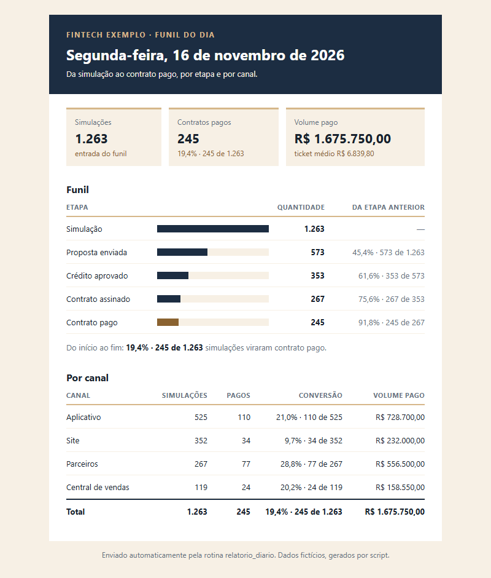

# Rotinas agendadas no Windows

Um executor pequeno para rotinas que rodam sozinhas no Agendador de Tarefas do Windows. Ele impede execução dupla, guarda log com rotação, corta pelo tempo limite, tenta de novo quando o erro é passageiro e grava o estado de cada execução. Em volta dele há um painel de saúde, o registro das tarefas a partir de um JSON, um e-mail diário em HTML e um backup com retenção.

## O problema

No trabalho, mantenho dez rotinas assim num PC com Windows: cargas de dados a cada 15 minutos, e-mails diários antes da reunião da manhã e backup de madrugada. Os problemas são sempre os mesmos: uma carga lenta encavala na seguinte; uma queda de rede derruba o e-mail das 08:30; o PC desliga no meio de uma execução e deixa uma trava para trás; e ninguém percebe que o backup parou há uma semana. Este projeto refaz esse padrão do zero, para uma empresa fictícia, a Fintech Exemplo.

## Como rodar

Python 3.10 ou mais novo, só com a biblioteca padrão, e Windows PowerShell 5.1.

```powershell
python rotina.py carga_propostas            # o comando e os limites vêm do rotinas.json
python rotina.py exportacao --espera 1 -- python exemplos/tarefa_ficticia.py "exportação" --falha passageira
python painel.py                            # saúde das rotinas; sai com 1 se algo não está em ordem
python painel.py --agora 2026-11-17T09:00   # como estará nesse horário, se nada mais rodar
python relatorio_diario.py                  # gera saida/relatorio-AAAA-MM-DD.html e .eml (envia só com --enviar)
.\agendar_rotinas.ps1                       # só mostra o que registraria; grava com -Registrar
.\backup.ps1 -Origem dados -Destino D:\backups -Manter 7 -WhatIf
python -m unittest discover -s testes -v
```

Se a política de execução bloquear os `.ps1`, rode com `powershell -ExecutionPolicy Bypass -File .\agendar_rotinas.ps1`.

O `rotina.py` sai com estes códigos:

| Código | Quando |
|---|---|
| 0 | deu certo |
| 3 | pulada: a execução anterior da mesma rotina ainda está rodando |
| 75 | erro passageiro que continuou depois de todas as tentativas |
| 124 | estourou o tempo limite |
| 127 | o comando não iniciou (não existe ou falta permissão) |
| outro | o código do próprio comando |

Para o `--enviar` do e-mail, defina `SMTP_HOST`, `SMTP_PORT` (587 por padrão; 465 usa SSL direto), `SMTP_USUARIO`, `SMTP_SENHA` e `DESTINATARIOS` (separados por vírgula). No trabalho, o envio sai pelo Outlook da própria máquina; aqui ficou o SMTP da biblioteca padrão, para o projeto rodar em qualquer lugar.

## Estrutura

```
02-rotinas-agendadas/
├── rotina.py                   executor: trava, log, tempo limite, novas tentativas e estado
├── painel.py                   tabela de saúde a partir de estado/*.json
├── rotinas.json                as rotinas: comando, agenda e limites
├── agendar_rotinas.ps1         registra as tarefas no Agendador (sem -Registrar, só simula)
├── relatorio_diario.py         e-mail HTML do funil do dia (.html e .eml; SMTP com --enviar)
├── backup.ps1                  zip com data no nome, retenção dos N últimos e log; -WhatIf simula
├── exemplos/tarefa_ficticia.py tarefa de mentira usada pelas rotinas de exemplo
├── testes/                     unittest
├── img/relatorio.png           captura do e-mail
└── estado/ logs/ saida/        criadas ao rodar (fora do git)
```

## Exemplo de saída

Uma rotina com falha passageira, como fica em `logs/atualiza_indicadores.log`:

```
2026-11-16 14:32:30 INFO  Início: python exemplos/tarefa_ficticia.py "atualização dos indicadores" --segundos 0.5 --falha passageira
2026-11-16 14:32:31 INFO  | Começando: atualização dos indicadores.
2026-11-16 14:32:31 INFO  | Servidor de origem ocupado; vale tentar de novo.
2026-11-16 14:32:31 AVISO Falha passageira (tentativa 1 de 3); nova tentativa em 1 s.
2026-11-16 14:32:32 INFO  | Começando: atualização dos indicadores.
2026-11-16 14:32:32 INFO  | Servidor de origem ocupado; vale tentar de novo.
2026-11-16 14:32:32 AVISO Falha passageira (tentativa 2 de 3); nova tentativa em 2 s.
2026-11-16 14:32:35 INFO  | Começando: atualização dos indicadores.
2026-11-16 14:32:35 INFO  | Servidor de origem ocupado; vale tentar de novo.
2026-11-16 14:32:35 ERRO  Fim: erro (código 75, 3 tentativa(s)): Servidor de origem ocupado; vale tentar de novo.
```

O estado que ela deixa em `estado/atualiza_indicadores.json`:

```json
{
  "rotina": "atualiza_indicadores",
  "inicio": "2026-11-16T14:32:30-03:00",
  "fim": "2026-11-16T14:32:35-03:00",
  "duracao_s": 5.0,
  "resultado": "erro",
  "codigo_saida": 75,
  "tentativas": 3,
  "erro": "Servidor de origem ocupado; vale tentar de novo."
}
```

(O arquivo também guarda o comando e o PID.) E o painel logo depois:

```
ROTINA                  AGENDA           ÚLTIMO INÍCIO     DURAÇÃO  TENTATIVAS  RESULTADO  SITUAÇÃO
carga_propostas         a cada 15 min    16/11/2026 14:32  1,2 s    1           ok         em dia
atualiza_indicadores    a cada 60 min    16/11/2026 14:32  5,0 s    3           erro 75    com erro
conferencia_pagamentos  seg a sex 07:00  —                 —        —           —          nunca rodou
relatorio_diario        seg a sex 08:30  16/11/2026 14:32  0,3 s    1           ok         em dia
backup_diario           todo dia 02:00   —                 —        —           —          nunca rodou

Erro da última execução:
  atualiza_indicadores: Servidor de origem ocupado; vale tentar de novo.

Em ordem: 2 de 5 rotinas (avaliado em 16/11/2026 14:32).
```

Com `--agora 2026-11-17T09:00`, `carga_propostas` e `relatorio_diario` passam a aparecer como `atrasada`.

O e-mail do funil do dia, como chega na caixa de entrada:



## Decisões técnicas

- **A trava guarda o PID do dono.** Se o PC desliga no meio de uma execução, a trava fica para trás; a execução seguinte vê que o dono morreu e a libera. Uma validade máxima, igual ao pior caso de tempo da rotina, cobre o PID que o Windows já deu a outro processo. No Agendador, "não abrir outra instância" é a segunda barreira.
- **Só repete o que é passageiro.** Repetir erro definitivo (dado inválido, bug) só atrasa o alarme. O comando avisa que a falha é passageira saindo com 75 (`EX_TEMPFAIL`, do `sysexits.h`), e a espera dobra a cada tentativa (30 s, 60 s, 120 s…). Tempo limite estourado não se repete: repetir uma carga lenta só dobra o atraso.
- **Estado gravado de forma atômica** (arquivo temporário e `os.replace`): o painel nunca lê um JSON pela metade. Um estado "rodando" cujo processo já morreu aparece como `interrompida`.
- **Saída do comando num arquivo temporário, não num pipe:** um comando que escreve muito não fica travado esperando leitura, e stdout e stderr chegam juntos ao log.
- **O Agendador só guarda a agenda.** Cada tarefa chama `python rotina.py <nome>`; o comando e os limites ficam no `rotinas.json`, então mudar o comando não exige registrar a tarefa de novo. Com `StartWhenAvailable`, a rotina perdida roda quando o PC volta a ligar.
- **E-mail feito para o Outlook,** que desenha HTML com o motor do Word: layout em tabelas, CSS inline, cor repetida em `bgcolor`, barras feitas de células e nenhum JavaScript, além de uma versão em texto puro.
- **Backup que não engana a retenção:** o zip nasce como `.parcial` e só ganha o nome final quando termina, então um backup interrompido nunca conta como um dos N guardados.

Todos os dados são fictícios, gerados por script.
