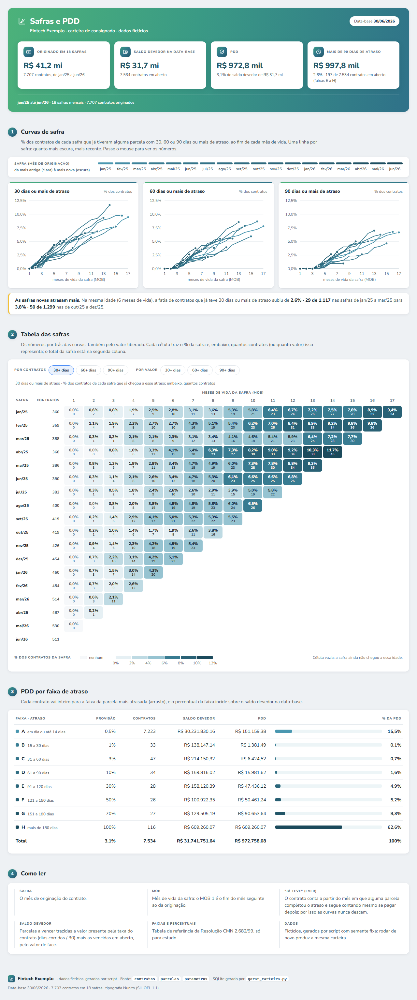

# Safra e PDD de uma carteira de consignado

Análise de inadimplência por safra (*vintage*) e cálculo da PDD (provisão para devedores duvidosos) de uma carteira fictícia de crédito consignado da **Fintech Exemplo**. Um script gera a carteira em SQLite; os outros calculam as curvas de safra e a PDD na data-base e montam um relatório HTML num arquivo só.

## O problema real

Quem acompanha uma carteira de crédito, seja a área de cobrança ou o fundo que compra os contratos, precisa responder todo mês a duas perguntas:

1. **As safras novas estão piores que as antigas *na mesma idade*?** Comparar o atraso de hoje mistura contratos de idades diferentes; a curva de safra compara mês de vida com mês de vida.
2. **Quanto da carteira precisa estar provisionado para perda?** Cada contrato é classificado pelo atraso e um percentual da faixa incide sobre o saldo devedor.

## Como rodar

Python 3.10 ou mais novo, só a biblioteca padrão. Na pasta do projeto:

```bash
python gerar_carteira.py    # dados/carteira.sqlite: 18 safras, data-base 30/06/2026
python safra.py             # matriz safra × MOB no terminal + saida/curvas_safra.svg
python pdd.py               # PDD por faixa no terminal + saida/pdd_por_faixa.svg
python relatorio.py         # saida/relatorio.html
python -m unittest discover -s testes -v
```

`dados/` e `saida/` ficam fora do repositório: os comandos acima recriam tudo igual, porque o gerador usa semente fixa.

## Estrutura

```
04-safra-e-pdd/
├── gerar_carteira.py   contratos, parcelas pela tabela Price e pagamentos simulados
├── safra.py            curvas "ever" 30+, 60+ e 90+ por safra e MOB, por contratos e por valor
├── pdd.py              faixas A a H, arrasto, saldo devedor e PDD
├── relatorio.py        HTML autocontido com os gráficos, as tabelas e a fonte embutida
├── graficos.py         SVG feito à mão (linhas, barras, rampas de cor, contraste da WCAG)
├── comum.py            datas, dinheiro e formatação brasileira
├── fontes/             Nunito (SIL OFL 1.1): o arquivo woff2 que vai dentro do relatório e a licença
├── testes/             unittest (Price, faixas, arrasto, curvas, relatório e cores)
└── img/relatorio.png   captura do relatório
```

## Exemplo de saída



## Decisões técnicas

- **O banco é uma foto da data-base.** Pagamento feito depois dela não existe no banco, e a própria data-base fica gravada na tabela `parametros`; as análises leem dali.
- **Dinheiro sem `float`.** Centavos inteiros no SQLite e `Decimal` no Python, sempre arredondados ao centavo com regra explícita (meio centavo para cima). Na tabela Price, os juros são arredondados mês a mês e a última parcela absorve a sobra, então as amortizações somam exatamente o principal (há teste para isso).
- **Safra, MOB e "ever".** Safra é o mês de originação; o MOB *k* é o fim do *k*-ésimo mês depois dele; "30+" quer dizer 30 dias ou mais. O contrato passa a contar no dia em que alguma parcela completa o atraso e não sai mais, mesmo que pague depois. Por isso as curvas nunca descem (também testado). As taxas saem por número de contratos e por valor liberado.
- **PDD.** O contrato vai inteiro para a faixa da parcela mais atrasada (arrasto; a norma também arrasta as outras operações do mesmo cliente, e aqui cada cliente tem um contrato só). Saldo devedor = parcelas a vencer trazidas a valor presente pela taxa do contrato (dias corridos / 30) + vencidas em aberto pelo valor de face. A PDD é arredondada contrato a contrato, e o total é a soma das linhas.
- **Tabela de referência, não regra em vigor.** As faixas e os percentuais (A 0,5% · B 1% · C 3% · D 10% · E 30% · F 50% · G 70% · H 100%) são os da Resolução CMN 2.682/99. Para os bancos, ela foi substituída pela Resolução CMN 4.966/2021 (perda esperada, em vigor desde 2025), e cada fundo segue a política do seu administrador. Aqui é só a tabela de referência, para estudo.
- **Dados com um padrão de propósito.** Com o desconto em folha, o cliente paga em dia. Se perde o emprego, os descontos param, e metade volta a pagar semanas depois. Cada safra sai um pouco mais arriscada que a anterior, para as curvas mostrarem o que a análise de safra existe para pegar.
- **Simplificações.** Não há liquidação antecipada, renegociação, multa e juros de mora, baixa para prejuízo nem contagem em dobro dos prazos para operações longas.
- **Visual de painel.** Faixa do topo em degradê com os quatro indicadores em cartões brancos, seções numeradas, gráficos e tabelas em cartões com sombra curta, nota de leitura com fio à esquerda e a fonte das tabelas no rodapé. Tipografia: Nunito (SIL OFL 1.1), de The Nunito Project Authors; a licença está em `fontes/OFL.txt`.
- **Cor com função, e contraste calculado (não no olho).** As safras ficam numa rampa de teal, da mais antiga (clara) à mais nova (escura), e as faixas da PDD escurecem com o atraso. Linha e barra têm pelo menos 3:1 contra o branco: o tom mais claro, `#4a97b0`, dá 3,31:1. O mapa de calor usa até 7 classes de limites redondos e mostra o percentual com o número absoluto embaixo. Os tons claros são o `#4a97b0` misturado com branco, o que mantém a matiz, e levam texto escuro; os escuros vêm da rampa e levam texto branco. Toda célula tem 4,5:1 ou mais, de 4,76:1 a 12,66:1. O meio da rampa fica de fora porque nele nem o branco nem o texto escuro chegam a 4,5:1. Há teste para tudo isso.
- **Sem dependências.** Os gráficos são SVG gerado pelo próprio Python, e o relatório é um HTML só, sem CDN nem JavaScript: a fonte vai dentro dele em base64, e as abas da tabela funcionam só com CSS. Em tela estreita, os cartões empilham e as tabelas rolam dentro do cartão.

> Todos os dados são fictícios, gerados por script.
