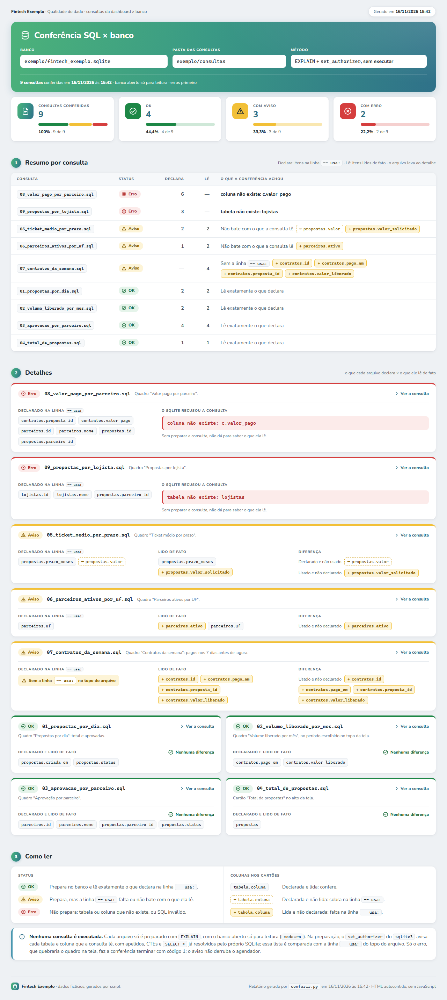

# 05 · Conferência automática das consultas SQL

Confere, sem executar nada, se cada consulta `.sql` de uma dashboard ainda roda no banco e se lê exatamente as colunas que diz usar. Gera um relatório em Markdown e em HTML e termina com código de saída 1 quando alguma consulta quebrou, para rodar num agendador ou no CI.

> Todos os dados são fictícios, gerados por script.



## O problema

Cada quadro de uma dashboard tem a sua consulta, escrita em momentos diferentes. O banco muda por baixo (coluna renomeada, tabela trocada, filtro novo) e o quadro só quebra quando alguém abre a tela. A anotação de "de onde vem esse número" envelhece sem ninguém perceber. No trabalho conferi centenas de quadros contra o banco; aqui a técnica está refeita do zero, numa empresa fictícia, a Fintech Exemplo.

## Como rodar

Python 3.10 ou mais novo, só a biblioteca padrão. Da pasta do projeto:

```bash
python exemplo/criar_banco.py        # cria exemplo/fintech_exemplo.sqlite (semente 42)
python conferir.py exemplo/fintech_exemplo.sqlite exemplo/consultas
python -m unittest discover -s testes -v
```

Os relatórios saem em `saida/relatorio.md` e `saida/relatorio.html` (um terceiro argumento troca a pasta). Código de saída: `0` sem erro (aviso não derruba), `1` se alguma consulta tem erro, `2` se o banco ou a pasta não existem.

## Como funciona

Cada consulta declara no topo o que usa:

```sql
-- usa: propostas.criada_em, propostas.status
SELECT date(criada_em) AS dia, COUNT(*) AS propostas ...
```

1. **Prepara sem trazer dados.** `EXPLAIN <consulta>` compila a consulta e devolve o programa do SQLite, não as linhas. Tabela ou coluna que não existe aparece aqui: **erro**.
2. **Descobre o que a consulta lê de verdade.** Durante a preparação, o `set_authorizer` do `sqlite3` recebe um evento `SQLITE_READ` com a tabela e a coluna de cada leitura. Sem parser de SQL: apelidos, CTEs, subconsultas e `SELECT *` já chegam resolvidos pelo próprio SQLite.
3. **Compara declarado × usado.** "Declarado e não usado" ou "usado e não declarado": **aviso**. Faltar a linha `-- usa:` também é aviso.
4. **Relatório** em Markdown (para revisão ou wiki) e em HTML autocontido, com os erros primeiro. O HTML segue o visual das dashboards que eu faço no trabalho: faixa em degradê com o banco e a pasta conferidos, tiles com o total e cada status (percentual sempre com o absoluto, como "44,4% · 4 de 9"), a tabela das consultas e um cartão por consulta com o que ela declara, o que lê de fato e a diferença. As colunas que sobram na declaração aparecem riscadas (`−`) e as que faltam, destacadas (`+`); o arquivo na tabela leva ao cartão.

## Exemplo de saída

```text
$ python conferir.py exemplo/fintech_exemplo.sqlite exemplo/consultas
Conferência de 9 consultas contra exemplo/fintech_exemplo.sqlite
  erro   08_valor_pago_por_parceiro.sql: coluna não existe: c.valor_pago
  erro   09_propostas_por_lojista.sql: tabela não existe: lojistas
  aviso  05_ticket_medio_por_prazo.sql: declarado e não usado: propostas.valor; usado e não declarado: propostas.valor_solicitado
  aviso  06_parceiros_ativos_por_uf.sql: usado e não declarado: parceiros.ativo
  aviso  07_contratos_da_semana.sql: sem a linha "-- usa:" no topo; usado e não declarado: contratos.id, contratos.pago_em, contratos.proposta_id, contratos.valor_liberado
  ok     01_propostas_por_dia.sql: declaração confere
  ok     02_volume_liberado_por_mes.sql: declaração confere
  ok     03_aprovacao_por_parceiro.sql: declaração confere
  ok     04_total_de_propostas.sql: declaração confere
Total: 4 ok, 3 com aviso, 2 com erro
Relatórios: saida/relatorio.md e saida/relatorio.html
```

Os problemas foram plantados de propósito:

| Consulta | O que mudou | Resultado |
| --- | --- | --- |
| `05_ticket_medio_por_prazo` | a consulta passou a usar `valor_solicitado`; a declaração ainda diz `valor` | aviso |
| `06_parceiros_ativos_por_uf` | ganhou o filtro `ativo = 1` sem atualizar a declaração | aviso |
| `07_contratos_da_semana` | nunca teve a linha `-- usa:` | aviso |
| `08_valor_pago_por_parceiro` | usa `contratos.valor_pago`, coluna que não existe | erro |
| `09_propostas_por_lojista` | a tabela `lojistas` virou `parceiros` | erro |

## Decisões técnicas

- **`EXPLAIN` em vez de executar:** confere centenas de consultas em segundos, sem pesar no banco; e o banco ainda abre só para leitura (`mode=ro`).
- **`set_authorizer` em vez de parser de SQL:** quem resolve apelidos e CTEs é o próprio SQLite. A conexão abre com `cached_statements=0`, porque um comando que já está no cache não passa de novo pelo authorizer.
- **Tabela sem coluna** (um `COUNT(*)`) é declarada só pelo nome: `-- usa: propostas`. **Visão** conta como tabela: o que ela lê por dentro não entra.
- **Parâmetros nomeados** (`:inicio`, `:fim`) recebem NULL só para preparar a consulta; o valor não importa para a conferência.
- **Aviso não derruba o agendador**; só o erro, que é o que quebraria a tela.
- **HTML autocontido:** o CSS e a fonte Nunito (SIL OFL 1.1) vão dentro do arquivo, a fonte em base64; sem CDN nem JavaScript, o relatório abre igual sem internet, anexado num e-mail ou baixado do CI. Sem o arquivo da fonte, a página cai na fonte do sistema.
- **Status sempre com ícone e texto**, nunca só pela cor: quem não distingue o verde do vermelho lê o mesmo relatório.
- **Só a biblioteca padrão:** roda em qualquer máquina com Python, inclusive no CI.

## Estrutura

```text
05-conferencia-sql/
├── conferir.py              # linha de comando e conferência
├── relatorio.py             # relatório em Markdown e HTML
├── exemplo/
│   ├── schema.sql           # parceiros, propostas e contratos (Fintech Exemplo)
│   ├── criar_banco.py       # monta o SQLite com linhas fictícias
│   └── consultas/           # 9 consultas, 5 com problema de propósito
├── fontes/                  # Nunito em woff2 (vai embutida no HTML) e a licença OFL
├── testes/test_conferir.py  # 39 testes (unittest)
├── img/relatorio.png        # captura do relatório HTML
└── saida/                   # relatórios gerados (fora do git)
```

## Créditos

Fonte do relatório: Nunito (SIL OFL 1.1), de The Nunito Project Authors. A licença está em [`fontes/OFL.txt`](fontes/OFL.txt).
