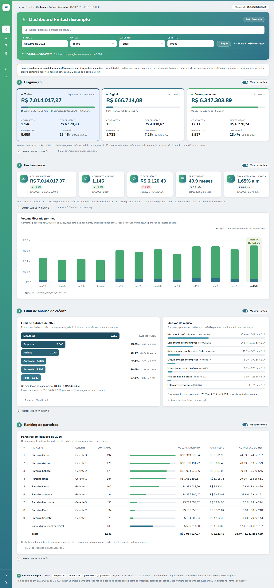
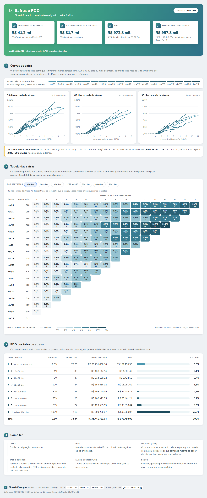

# Portfólio de dados · Felipe Menezes

Estagiário em Análise de Dados no mercado de crédito e estudante de Sistemas de Informação no Mackenzie.
Aqui estão, refeitos do zero, os tipos de projeto que eu construo no trabalho: BI, automação, arquivos
financeiros, risco de crédito e qualidade do dado.

> **Tudo aqui é fictício.** Nenhum código, regra ou dado da empresa onde trabalho está neste repositório.
> A empresa dos exemplos, a "Fintech Exemplo", é inventada, e os dados são gerados por script com semente
> fixa: rodando de novo, sai igual.

<p>
  
  
</p>

## Projetos

| | Projeto | O que mostra |
|---|---|---|
| 01 | [Dashboard de BI](01-dashboard-bi/) | Banco → SQL → regras em Python → página com gráficos em SVG. O recorte por perfil acontece antes de a página existir, e cada quadro tem um "fonte" com a consulta de origem. |
| 02 | [Rotinas agendadas](02-rotinas-agendadas/) | Executor de rotinas com trava, log, novas tentativas e estado em JSON; painel de saúde; e-mail diário em HTML; backup. |
| 03 | [Leitor de CNAB 444](03-leitor-cnab-444/) | Arquivo posicional de FIDC: layout declarativo, validação com a linha e a posição de cada erro, exportação para o Excel. |
| 04 | [Safra e PDD](04-safra-e-pdd/) | Curvas de inadimplência por safra (vintage) e provisão por faixa de atraso, com arrasto. |
| 05 | [Conferência SQL × banco](05-conferencia-sql/) | Confere se cada consulta de uma dashboard ainda bate com o banco: tabela ou coluna que sumiu e colunas declaradas × usadas. |
| 06 | [Databricks: Lakehouse Federation](06-databricks-federation/) | Guia para consultar um PostgreSQL de produção no Databricks sem copiar os dados: conexão, catálogo, permissões, rede, fuso e custo. |
| 07 | [Transcrição de reuniões](07-transcricao-reunioes/) | Áudio de reunião → texto com horário (Whisper) → lista de pedidos para revisar. |

## Tecnologias

Python (só a biblioteca padrão), SQL e SQLite, HTML/CSS e SVG, PowerShell e Agendador de Tarefas do
Windows, Databricks SQL e Unity Catalog, faster-whisper (opcional, no 07).

As páginas seguem o padrão visual dos painéis que eu construo: faixa de filtros e barra lateral em
degradê verde → teal, cartões brancos com sombra curta, seções numeradas e a fonte Nunito embutida, para
cada HTML abrir igual em qualquer máquina, sem internet.

## Como rodar

Python 3.10 ou mais novo; não é preciso instalar nada (só o 07 usa um pacote opcional). Cada pasta tem um
README com os comandos e os testes. Por exemplo:

```bash
cd 01-dashboard-bi
python build.py
python -m unittest discover -s testes -v
```

## Como eu trabalho

- Todo número tem a consulta de origem à vista, e todo percentual vem com o absoluto ao lado
  ("18,4% · 1.042 de 5.659").
- Cada projeto tem a sua suíte de testes, que roda antes de qualquer entrega.
- Uso IA (Claude Code) como ferramenta de desenvolvimento e confiro o resultado contra o dado.

## Contato

[LinkedIn](https://www.linkedin.com/in/felipe-menezes-823579326)

## Créditos

Fonte [Nunito](https://github.com/googlefonts/nunito), sob a SIL Open Font License 1.1; a licença acompanha
cada pasta `fontes/`.
